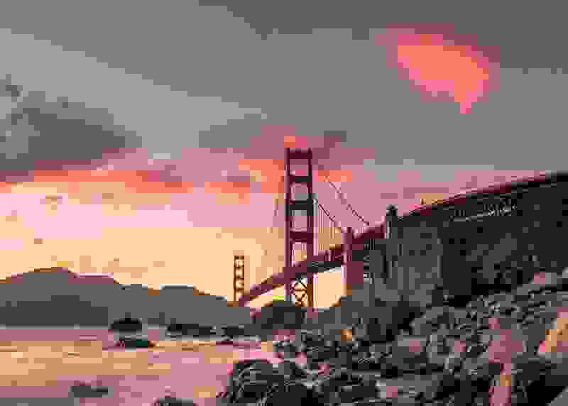
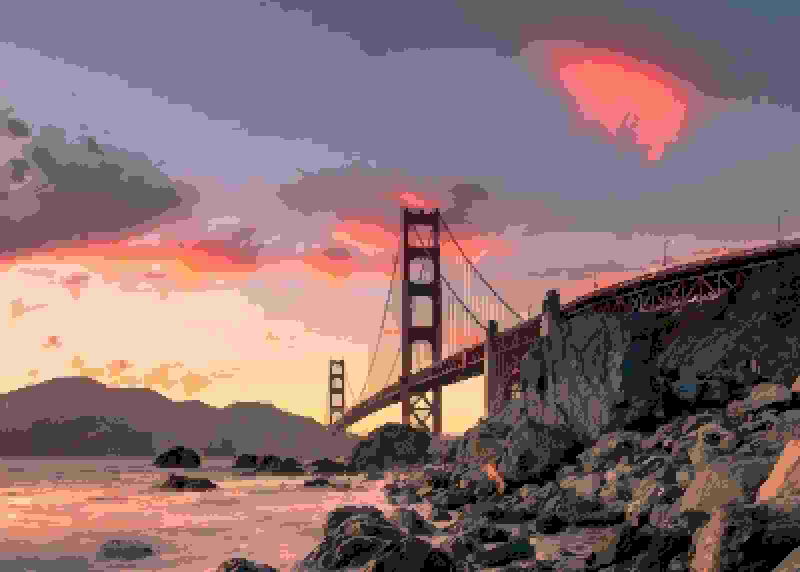

# Babe — Bi-Level Adaptive Block Encoding

**Babe** is an experimental dual‑tone block-based image codec designed for extremely lightweight compression with visually smooth output.
The encoder uses byte-symbol range coding with local frequency tables, parallel processing and reusable buffers. Qualities 0–99 are lossy; quality 100 preserves opaque 8-bit RGB pixels exactly.

**Implementation comparison:** BABE is implemented in pure Go. The benchmarks
also use C/C++ and Rust reference tools, some with SIMD acceleration; QOI and
the initial PNG encoder in these measurements are Go implementations. See the
settings and methodology below when comparing their results.

## Features

- Two‑tone block encoding with adaptive subdivision
- Quality-dependent quantization of YCbCr block levels
- Delta-coded block levels
- Byte-symbol range coding with parallel stream compression and decompression
- Lossy qualities 0–99 and lossless 8-bit RGB at quality 100
- Minimal API: `Encode(image, quality, bw)` and `Decode(data, postfilter)`

## How It Works

At a high level, Babe is a block-based codec with a dual-tone model per block and three independent color streams.

1. **Color space and input**
   - At qualities 0–99 the source image is converted to a YUV-like space. At quality 100, the channels are instead `G`, `B-G`, and `R-G`, using reversible byte arithmetic.
   - Luma and chroma are processed with different sensitivity so that most detail is preserved in brightness while color is simplified more aggressively.

2. **Block partitioning**
   - The image is split into rectangular blocks (macroblocks).
   - Blocks can be further subdivided adaptively depending on local contrast and quality settings.
   - Very flat or low-contrast regions tend to keep larger blocks; detailed regions get smaller blocks.

3. **Dual-tone model**
   - For each block Babe tries to represent its channel values using only **two levels** (a “dual-tone”). At quality 100 a 2×2 block is used only if the levels reproduce every sample exactly; otherwise it splits into 1×1 blocks.
   - A simple pattern (bit mask) inside the block tells, for each pixel, which of the two tones is used.
   - This creates a kind of ordered dither / posterization that looks smooth at a distance but is cheap to store.

4. **Block-level quantization**
   - Each block's foreground and background levels are rounded according to quality.
   - Chroma uses coarser steps than luma. If both levels become equal, the block is stored as solid, without a pattern or background value.
   - Quantization steps and block decisions follow an empirical quality curve; they change gradually through qualities 0–99. Quality 100 uses no quantization or block approximation.
   - At quality 0, 2×2 luma samples are averaged, 8×8 macroblocks are used wherever they fit, and chroma blocks are stored as solid colors. At higher qualities, less smoothing is applied and more blocks retain color detail.
   - At quality 100 opaque 8-bit RGB pixels are restored exactly. Transparency and 16-bit inputs are rejected in this mode. For JPEG input this means the decoded 8-bit RGB pixels, not the original JPEG bitstream or metadata. BW mode at quality 100 requires an already grayscale image.

5. **Delta coding**
   - Foreground and background values are stored as byte differences from the preceding value in their respective streams.

6. **Pattern and metadata encoding**
   - Each channel has block size flags, solid/pattern flags, pattern bits, foreground values and background values.
   - Solid blocks have no pattern or background entry.

7. **Bitstream layout**
   - Channels are independent. The header contains dimensions, block sizes and a channel mask; BW mode stores only luma.

8. **Range compression**
   - Each stream is split into blocks of up to 32 KiB, with one frequency table per block. The range coder processes a whole byte per step. Constant blocks store a single repeated byte; incompressible blocks or streams are stored raw when that is smaller.
   - New files always use the `BRC1` container with a checksum. There is no search across codecs or context models, and Zstd is not used for encoding.
   - Up to four entropy workers process independent streams. Small payloads run serially; `Encoder.Parallel` and `Decoder.Parallel` also control these workers.
   - The decoder still accepts older binary-range and Zstd-based `.babe` files, including mixed range/Zstd `BRC1` files. Older programs do not support the new byte-range method (16) or the lossless color flag.

9. **Decoding**
   - Decode reverses the process:
     - Decompress range-coded or Zstd streams and restore the block parameters.
     - Reconstruct each block’s two tones and pattern.
     - Stitch the blocks into a full-resolution image and restore RGB using the color transform indicated in the header.
   - PNG export uses standard lossless compression for faster writing. Compared with maximum PNG compression, files can be slightly larger; decoded pixels are identical.

The format remains experimental. See [the BRC1 layout](docs/BRC1.md) for the container specification.

## CLI Utility

Build and run from the repository directory:

```sh
go build -o Babe .
./Babe 1.jpg 10 1.png
```

This writes `1.babe` and immediately decodes it into `1.png`. Range coding is enabled by default; no compression flag is needed. Use `./Babe 1.jpg 10 bw 1.png` for grayscale.

To try experimental reconstruction of larger glyphs, use one option:

```sh
./Babe 1.jpg 10 -smooth 1.png
./Babe 1.babe -smooth
```

`-smooth` stores selective source corners and combines corner gradients,
low-contrast glyph smoothing and a gradual correction near block boundaries.
It leaves luma glyphs of 4×4 and smaller unchanged during smoothing, and uses
each color channel's block sizes when reconstructing larger glyphs. A selected
large gradient replaces the luma representation for its entire area. It can soften real
low-contrast details. The option must also be specified when decoding; an
existing lossy file must contain stored corners (BGC1 or BGC2). Lossless q100
is unchanged. In Go, set `Encoder.SparseCorners = true`,
`Encoder.CornerMinSize = 5` and `Decoder.Smooth = true`.

When encoding lossy images, `-smooth` also tries large 16×16, 32×32 and 64×64
luminance gradients. The encoder fits each candidate to the source and splits
areas with excessive error into smaller candidates, leaving details to normal
glyphs. Neighbouring gradient blocks share boundary vertices on a 16-pixel grid,
including intermediate vertices where blocks of different sizes meet. The
decoder interpolates each block using its boundary vertices; small mismatches
against ordinary glyphs are faded into the gradient. This experimental representation uses a `BGG2` wrapper and is decoded
automatically; existing BABE decoders cannot read it. It keeps constant base
glyphs under the gradients, so it is a prototype rather than a fully compact
block format, and can increase file size. Gradient selection currently uses
fixed error limits, not an exact rate–distortion search. The experiment is
disabled for lossless q100. In Go, enable it with `Encoder.LargeGradients`.

To inspect the stored glyphs without color, render the first channel as
grayscale:

```sh
./Babe 1.jpg 10 -glyphs-only 1-glyphs-only.png
./Babe 1.babe -glyphs-only
```

This displays the raw reconstructed luma channel before the experimental
corner gradient and glyph blending. It retains the glyphs' brightness levels;
it is not a binary mask. For lossless q100, the first channel is green rather
than luma, so this diagnostic view intentionally does not reproduce RGB.
In Go use `Decoder.GlyphsOnly`.

### Encode an image → `.babe`

```
./Babe input.jpg
```

Produces:

```
input.babe
```

Default quality is **70**. Lower quality prioritizes smaller files; **100**
uses lossless mode for opaque 8-bit RGB images. The scale is calibrated for a
more even size progression on several photos, but it is not a target file size:
content, block boundaries and entropy coding can make individual steps uneven.
Perceptual quality cannot be guaranteed to progress linearly, and q100 uses a
different lossless color transform. Numeric qualities 1–99 produce different
results than earlier versions.

Specify a custom quality (0–100):

```
./Babe input.jpg 5
```

### Decode `.babe` → PNG

```
./Babe input.babe
```

Produces:

```
input.png
```

## API Usage

### Encode

```go
comp, err := Encode(img, quality, false)
if err != nil {
    // handle error
}
```

### Decode

```go
img, err := Decode(compData, false)
if err != nil {
    // handle error
}
```

`Decode` returns a standard `image.Image`.


## Status

This codec is currently experimental.
Format details, quality tuning, and performance optimizations are still evolving.

In-memory BABE encoder/decoder timings and size tradeoffs are recorded in [the speed measurements](docs/performance.md).

## Quality scale

BABE's quality scale was tuned for a more even size progression across several
photos, but neither file size nor perceived quality is guaranteed to change
linearly. Depending on the image, a higher quality can even yield a smaller
file. The lossless q100 uses a different color transform and preserves opaque
8-bit RGB exactly. See [quality measurements](docs/performance.md#quality-scale)
for the method and limitations.

```sh
go run ./cmd/qualitycurve -input samples/source.jpg > /tmp/babe-quality.csv
```

## Benchmark comparison

### Lossless: complete encode/decode cycle

All codecs and JPEG XL settings received the same decoded 5152×7728 opaque 8-bit RGB image.
Each measurement is a complete encode followed by a decode, with separate
processes and disk I/O included. After warm-up, three rounds were run in
shuffled order and every decoded image was checked pixel-for-pixel. The table
shows medians; the full-cycle time is measured directly, not added from the
separate encode and decode medians. CPU time sums all process threads, and
peak RSS is the largest individual process peak in the cycle.

| Lossless format | Encode | Decode | Full cycle | CPU / cycle | Peak RSS | Size |
|---|---:|---:|---:|---:|---:|---:|
| BABE q100 | 0.581 s | 0.586 s | 1.177 s | 1.978 s | 675.1 MiB | 44.09 MB |
| QOI | 1.249 s | 0.537 s | 1.787 s | 1.711 s | 316.6 MiB | 78.98 MB |
| JPEG XL, effort 1 | 0.136 s | 0.210 s | 0.345 s | 1.320 s | 470.2 MiB | 48.87 MB |
| JPEG XL, effort 5 | 3.619 s | 1.004 s | 5.051 s | 27.192 s | 780.8 MiB | 42.06 MB |
| PNG + OxiPNG | 12.426 s | 1.101 s | 13.526 s | 17.315 s | 819.2 MiB | 64.77 MB |
| WebP | 15.336 s | 0.644 s | 15.967 s | 15.473 s | 1149.2 MiB | 47.93 MB |

JPEG XL used distance 0 at efforts 1 and 5; WebP used lossless mode, quality 75,
method 4; PNG used Go's PNG encoder followed by OxiPNG `-o2`. These settings
affect both size and speed. Times include process startup and PPM input/output;
the image and settings differ from the JPEG comparison below. See
[methodology and per-round results](docs/performance.md#lossless-cli-comparison).

### JPEG and BABE at comparable sizes

The same 800×572 [source image](samples/source.jpg) was decoded to opaque RGB
and encoded by Go's JPEG encoder and BABE. Quality settings were selected for
similar encoded sizes **on this image**; equal quality numbers do not imply
equal size or visual quality. PSNR compares decoded RGB against the decoded
source (which is itself a JPEG); higher PSNR does not always mean a better
perceptual result.

Each time is a median of three complete encode/decode cycles after warm-up,
with process startup and disk I/O included. CPU is user plus system time across
threads; peak RSS is the highest individual process peak in the cycle. The
image is small, so process and file overhead account for a substantial portion
of these timings. The machine was heavily loaded during the latest run and
individual cycle times varied; see [per-round data and methodology](docs/performance.md#jpeg-at-comparable-sizes).

| Size target | Format and setting | Encoded size | RGB PSNR | Encode | Decode | Full cycle | CPU / cycle | Peak RSS |
|---|---|---:|---:|---:|---:|---:|---:|---:|
| Small | JPEG q1 | 9,256 B | 21.73 dB | 0.0134 s | 0.0127 s | 0.0258 s | 0.0227 s | 7.3 MiB |
| Small | BABE q0 | 8,843 B | 23.91 dB | 0.0106 s | 0.0106 s | 0.0213 s | 0.0244 s | 9.5 MiB |
| Medium | JPEG q80 | 71,042 B | 35.40 dB | 0.0163 s | 0.0138 s | 0.0297 s | 0.0257 s | 7.3 MiB |
| Medium | BABE q17 | 71,960 B | 30.47 dB | 0.0112 s | 0.0110 s | 0.0225 s | 0.0265 s | 9.8 MiB |

### Visual comparison

Click an image to inspect it at full resolution. JPEG previews are the encoded
JPEG files. BABE previews are decoded pixels saved losslessly as PNG; the
sizes above refer to the `.babe` bitstreams, not these PNG previews.

**Small:** JPEG q1 (9,256 B) on the left; BABE q0 (8,843 B) on the right.
BABE is 4.5% smaller.

<a href="samples/jpeg-q1.jpg"></a>
<a href="samples/babe-q0.png"></a>

**Medium:** JPEG q80 (71,042 B) on the left; BABE q17 (71,960 B) on the right.
BABE is 1.3% larger. JPEG has higher PSNR on this image at these sizes.

<a href="samples/jpeg-q80.jpg"></a>
<a href="samples/babe-q17.png"></a>

Recreate the images and size/PSNR figures with:

```sh
go run ./cmd/compareimages -input samples/source.jpg -out samples -jpeg-quality 1 -babe-quality 0
go run ./cmd/compareimages -input samples/source.jpg -out samples -jpeg-quality 80 -babe-quality 17
```

## License

MIT
