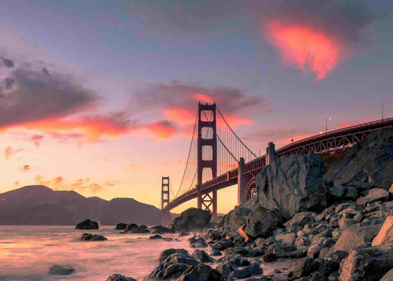
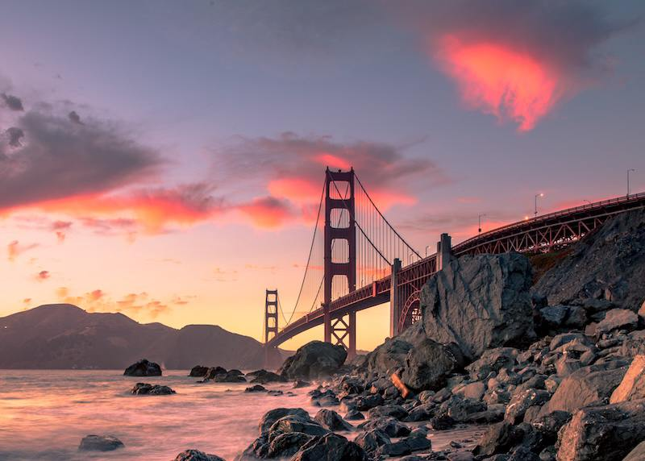

# Babe — Bi-Level Adaptive Block Encoding

**Babe** is an experimental dual‑tone block-based image codec designed for extremely lightweight compression with visually smooth output.
The encoder uses byte-symbol range coding with local frequency tables, parallel processing and reusable buffers. Qualities 0–99 are lossy; quality 100 preserves opaque 8-bit RGB pixels exactly.

## Features

- Two‑tone block encoding with adaptive subdivision
- Quality-dependent quantization of YCbCr block levels
- Delta-coded block levels
- Byte-symbol range coding with parallel stream compression and decompression
- Lossy qualities 0–99 and lossless 8-bit RGB at quality 100
- Minimal API: `Encode(image, quality, bw)` and `Decode(data, postfilter)`

## How It Works

At a high level, Babe is a block-based codec with a dual-tone model per block and three independent color streams.

1. **Color space and input**
   - At qualities 0–99 the source image is converted to a YUV-like space. At quality 100, the channels are instead `G`, `B-G`, and `R-G`, using reversible byte arithmetic.
   - Luma and chroma are processed with different sensitivity so that most detail is preserved in brightness while color is simplified more aggressively.

2. **Block partitioning**
   - The image is split into rectangular blocks (macroblocks).
   - Blocks can be further subdivided adaptively depending on local contrast and quality settings.
   - Very flat or low-contrast regions tend to keep larger blocks; detailed regions get smaller blocks.

3. **Dual-tone model**
   - For each block Babe tries to represent its channel values using only **two levels** (a “dual-tone”). At quality 100 a 2×2 block is used only if the levels reproduce every sample exactly; otherwise it splits into 1×1 blocks.
   - A simple pattern (bit mask) inside the block tells, for each pixel, which of the two tones is used.
   - This creates a kind of ordered dither / posterization that looks smooth at a distance but is cheap to store.

4. **Block-level quantization**
   - Each block's foreground and background levels are rounded according to quality.
   - Chroma uses coarser steps than luma. If both levels become equal, the block is stored as solid, without a pattern or background value.
   - Quantization steps for Y / Cb,Cr: quality 0–19: 4 / 8; 20–59: 2 / 4; 60–89: 1 / 2; 90–99: 1 / 1. Quality 100 uses no quantization or block approximation.
   - At quality 100 opaque 8-bit RGB pixels are restored exactly. Transparency and 16-bit inputs are rejected in this mode. For JPEG input this means the decoded 8-bit RGB pixels, not the original JPEG bitstream or metadata. BW mode at quality 100 requires an already grayscale image.

5. **Delta coding**
   - Foreground and background values are stored as byte differences from the preceding value in their respective streams.

6. **Pattern and metadata encoding**
   - Each channel has block size flags, solid/pattern flags, pattern bits, foreground values and background values.
   - Solid blocks have no pattern or background entry.

7. **Bitstream layout**
   - Channels are independent. The header contains dimensions, block sizes and a channel mask; BW mode stores only luma.

8. **Range compression**
   - Each stream is split into blocks of up to 32 KiB, with one frequency table per block. The range coder processes a whole byte per step. Constant blocks store a single repeated byte; incompressible blocks or streams are stored raw when that is smaller.
   - New files always use the `BRC1` container with a checksum. There is no search across codecs or context models, and Zstd is not used for encoding.
   - Up to four entropy workers process independent streams. Small payloads run serially; `Encoder.Parallel` and `Decoder.Parallel` also control these workers.
   - The decoder still accepts older binary-range and Zstd-based `.babe` files, including mixed range/Zstd `BRC1` files. Older programs do not support the new byte-range method (16) or the lossless color flag.

9. **Decoding**
   - Decode reverses the process:
     - Decompress range-coded or Zstd streams and restore the block parameters.
     - Reconstruct each block’s two tones and pattern.
     - Stitch the blocks into a full-resolution image and restore RGB using the color transform indicated in the header.
   - PNG export uses standard lossless compression for faster writing. Compared with maximum PNG compression, files can be slightly larger; decoded pixels are identical.

The format remains experimental. See [the BRC1 layout](docs/BRC1.md) for the container specification.

## CLI Utility

Build and run from the repository directory:

```sh
go build -o Babe .
./Babe 1.jpg 10 1.png
```

This writes `1.babe` and immediately decodes it into `1.png`. Range coding is enabled by default; no compression flag is needed. Use `./Babe 1.jpg 10 bw 1.png` for grayscale.

### Encode an image → `.babe`

```
./Babe input.jpg
```

Produces:

```
input.babe
```

Default quality is **70**. Lower quality prioritizes smaller files; **100**
uses lossless mode for opaque 8-bit RGB images.

Specify a custom quality (0–100):

```
./Babe input.jpg 5
```

### Decode `.babe` → PNG

```
./Babe input.babe
```

Produces:

```
input.png
```

## API Usage

### Encode

```go
comp, err := Encode(img, quality, false)
if err != nil {
    // handle error
}
```

### Decode

```go
img, err := Decode(compData, false)
if err != nil {
    // handle error
}
```

`Decode` returns a standard `image.Image`.


## Status

This codec is currently experimental.
Format details, quality tuning, and performance optimizations are still evolving.

In-memory BABE encoder/decoder timings and size tradeoffs are recorded in [the speed measurements](docs/performance.md).

## Benchmark comparison

Measured on an Apple M3 with Go 1.27.3 using the local `benchmark.jpg`
(5152×7728). Times are medians of three runs with two operations each, after
warm-up. The BABE quality-100 measurements were refreshed after introducing
lossless mode; other rows are from the earlier build. The same decoded RGBA image is fed to both encoders; image loading and
file I/O are excluded. Encoder buffers and BABE decoder buffers are reused.
JPEG decoding returns Go's native YCbCr image, while BABE returns RGBA. Results
vary with the image and machine load; the source image is itself a JPEG.

JPEG and BABE at quality 80, with lossless QOI for reference:

| Metric | JPEG (q=80) | BABE (q=80) | QOI |
|---|---:|---:|---:|
| Encode time | 0.786 s | 0.278 s | 1.096 s |
| Decode time | 0.420 s | 0.296 s | 0.300 s |
| Total | 1.206 s | 0.574 s | 1.396 s |
| Output size | 13.98 MB | 22.69 MB | 78.98 MB |

Total is the sum of the separately measured encode and decode medians.

JPEG and BABE at each requested quality, on the same image and under the same
conditions:

| Quality | JPEG encode | BABE encode | JPEG decode | BABE decode | JPEG size | BABE size |
|---:|---:|---:|---:|---:|---:|---:|
| 100 | 0.961 s | 0.426 s | 0.799 s | 0.449 s | 37.66 MB | 44.09 MB |
| 80 | 0.786 s | 0.278 s | 0.420 s | 0.296 s | 13.98 MB | 22.69 MB |
| 50 | 0.533 s | 0.354 s | 0.242 s | 0.336 s | 5.30 MB | 17.47 MB |
| 10 | 0.417 s | 0.249 s | 0.155 s | 0.135 s | 0.97 MB | 7.47 MB |
| 0 | 0.398 s | 0.280 s | 0.148 s | 0.217 s | 0.67 MB | 6.48 MB |

Go's JPEG encoder clamps quality 0 to **1**. Equal quality numbers do not mean
equal visual quality or equal file size; BABE quality 100 is lossless. MB is
1,000,000 bytes. This is one image, not a claim about every image or JPEG codec.

CPU and memory were measured separately on the same image, with each codec and
operation in its own process. CPU time sums user and system time across all
threads; cores is CPU time divided by elapsed time (1.0 means one fully used
core). Values are medians of three processes with two warmed operations each.

| Quality | Codec | CPU encode s | CPU decode s | Encode cores | Decode cores |
|---:|---|---:|---:|---:|---:|
| 100 | JPEG | 0.918 | 0.778 | 1.00 | 0.95 |
| 100 | BABE | 0.857 | 0.813 | 1.94 | 1.87 |
| 80 | JPEG | 0.765 | 0.454 | 0.98 | 0.95 |
| 80 | BABE | 0.669 | 0.591 | 2.25 | 2.12 |
| 50 | JPEG | 0.531 | 0.244 | 0.99 | 1.00 |
| 50 | BABE | 0.829 | 0.656 | 2.04 | 1.88 |
| 10 | JPEG | 0.416 | 0.159 | 0.99 | 1.00 |
| 10 | BABE | 0.574 | 0.333 | 2.19 | 2.37 |
| 0 | JPEG | 0.469 | 0.154 | 0.83 | 0.98 |
| 0 | BABE | 0.613 | 0.409 | 2.00 | 1.77 |
| Lossless | QOI | 1.038 | 0.279 | 0.99 | 0.98 |

Memory allocated during a warmed operation and peak resident memory of its
entire process, in MiB (1 MiB = 1,048,576 bytes):

| Quality | Codec | Alloc encode MiB/op | Alloc decode MiB/op | Peak RSS encode MiB | Peak RSS decode MiB |
|---:|---|---:|---:|---:|---:|
| 100 | JPEG | 0.00 | 56.98 | 443.7 | 156.2 |
| 100 | BABE | 0.03 | 0.00 | 762.2 | 390.5 |
| 80 | JPEG | 0.00 | 56.98 | 443.5 | 133.7 |
| 80 | BABE | 0.03 | 0.00 | 660.6 | 345.3 |
| 50 | JPEG | 0.00 | 56.97 | 443.4 | 125.4 |
| 50 | BABE | 0.03 | 0.01 | 554.3 | 207.1 |
| 10 | JPEG | 0.00 | 56.98 | 443.7 | 121.3 |
| 10 | BABE | 0.03 | 0.01 | 444.6 | 178.7 |
| 0 | JPEG | 0.00 | 56.98 | 443.4 | 120.9 |
| 0 | BABE | 0.03 | 0.01 | 443.9 | 174.9 |
| Lossless | QOI | 303.77 | 151.89 | 656.2 | 385.9 |

Allocation counts do **not** include retained buffers created during warm-up:
near-zero allocations do not mean near-zero memory use. Peak RSS includes
runtime startup, loading, warm-up, buffers and the timed operations. Encode
processes load the same RGBA source; decode processes load only the already
encoded bitstream, so encoder memory is excluded from decoder RSS. JPEG
decodes to YCbCr; BABE and QOI decode to RGBA. Memory figures depend on Go's
garbage collector, allocator and the OS and are not a pure codec-only peak.
See [resource measurement details](docs/performance.md#cpu-and-memory) for
the commands and raw results.

To reproduce these measurements with a local `benchmark.jpg`:

```sh
go test -run '^$' -bench '^BenchmarkQualityComparison$' -benchtime=2x -count=3
```

See [the speed measurements](docs/performance.md) for the BABE encoder, decoder
and complete encode/decode cycle comparison against the earlier version.

## Visual comparison

The same [800×572 source image](docs/comparison/source.jpg) was encoded by
each codec. Click an image to inspect it at full resolution.

Quality 80:

| JPEG q80 — 71,042 bytes | BABE q80 — 211,612 bytes |
|:---:|:---:|
| [](docs/comparison/jpeg-q80.jpg) | [](docs/comparison/babe-q80.png) |

Quality 0 (JPEG actually uses quality 1, its minimum):

| JPEG q1 — 9,256 bytes | BABE q0 — 60,738 bytes |
|:---:|:---:|
| [](docs/comparison/jpeg-q0.jpg) | [](docs/comparison/babe-q0.png) |

For a roughly equal-size comparison, JPEG at quality 73 uses 60,191 bytes,
versus 60,738 bytes for BABE q0:

| JPEG q73 — 60,191 bytes | BABE q0 — 60,738 bytes |
|:---:|:---:|
| [](docs/comparison/jpeg-q73.jpg) | [](docs/comparison/babe-q0.png) |

The JPEG images are the encoded JPEGs themselves. The BABE images are its
decoded pixels saved losslessly for display; the stated BABE sizes are the
`.babe` bitstreams, not the previews. RGB PSNR against the decoded source is
35.40 / 40.18 dB for JPEG / BABE at q80, and 21.73 / 30.20 dB at minimum
quality. On this source, BABE uses 2.98× as many bytes at q80 and 6.56× at q0.
At approximately 60 KB, JPEG q73 reaches 34.24 dB versus BABE q0's 30.20 dB;
PSNR is one measure and is not a complete measure of perceived quality. Equal
numeric quality does not mean equal bitrate or perceived quality. The source
was already JPEG-compressed.

Recreate the images and size/PSNR figures with:

```sh
go run ./cmd/compareimages -input docs/comparison/source.jpg -out docs/comparison -quality 80
go run ./cmd/compareimages -input docs/comparison/source.jpg -out docs/comparison -quality 0
go run ./cmd/compareimages -input docs/comparison/source.jpg -out /tmp/comparison-q73 -quality 73
cp /tmp/comparison-q73/jpeg-q73.jpg docs/comparison/
```

## License

MIT
